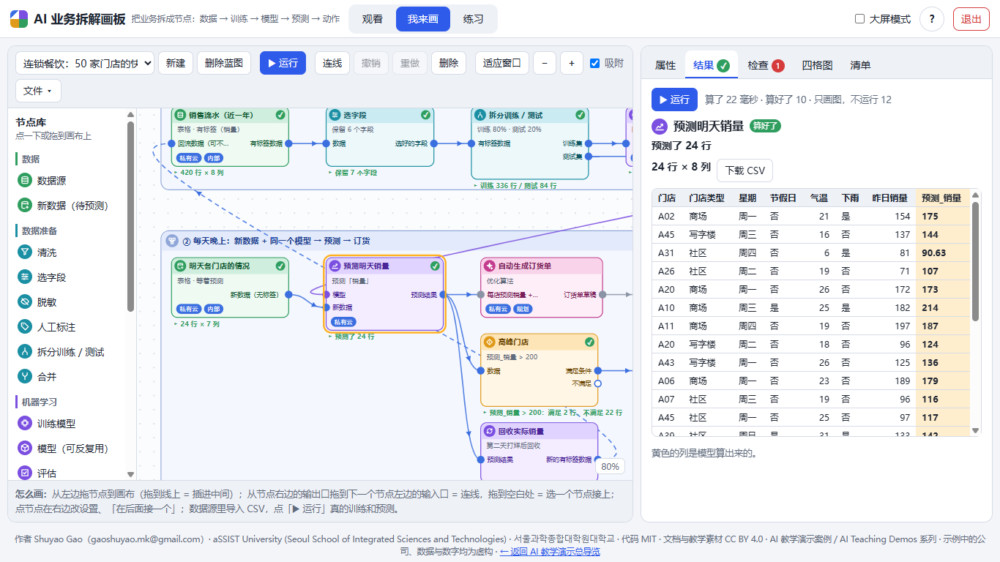
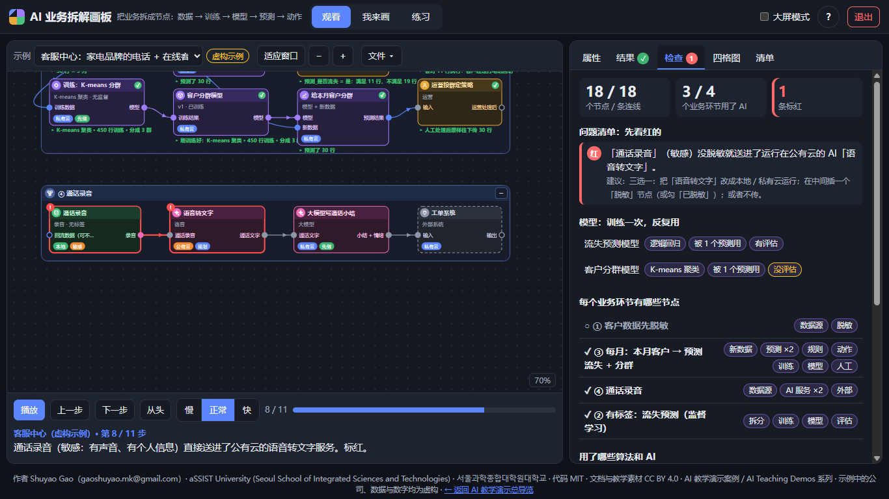
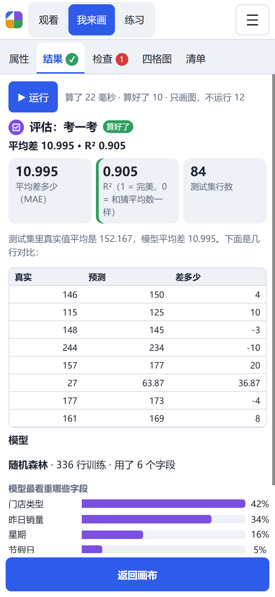

> [← 返回 AI 教学演示总导览](https://shuyaogao.github.io/)

> **AI 教学演示案例 / AI Teaching Demos** 系列

# AI 业务拆解画板（AI Business Blueprint）

**把业务拆成一个个首尾相连的节点：数据从哪来、有没有标签 → 怎么训练 → 得到什么模型 → 新数据来了怎么反复预测 → 预测完谁来做什么。**

**Shuyao Gao**（gaoshuyao.mk@gmail.com）· aSSIST University (Seoul School of Integrated Sciences and Technologies) · 서울과학종합대학원대학교
代码 MIT · 文档与教学素材 CC BY 4.0

给企业老板和管理层上 AI 课用的画板。第二版从「方框 + 箭头」改成了**节点图**：每个节点左边是输入口、右边是输出口，口对口连起来，类型对不上连不了。课堂上回答四件事：

1. **数据长什么样？** 表格、文字、图片还是录音；有没有标签（有没有「答案」那一列）；放在哪、有多敏感。
2. **机器学习这条线怎么走？** 数据 → 清洗 / 选字段 / 脱敏 / 人工标注 → 拆分训练集和测试集 → 训练（下拉选算法）→ 模型 → 评估。
3. **模型怎么反复用？** 模型锁定后，每天来一份新数据，接进同一个模型做预测；训练那一段跳过。真实结果出来后回收，变成下一轮的训练数据（数据飞轮）。
4. **哪里有风险？** 敏感数据顺着连线一路追：没脱敏就流到公有云上的训练、预测或 AI 服务，标红。

而且**真的能跑**：数据源里导入 CSV（或用内置的虚构数据），点「运行」，浏览器里训练、评估、预测，看得到准确率、平均差多少、模型最看重哪几个字段，预测结果可以下载成 CSV。不用安装、不用联网，纯手写 JavaScript，不依赖任何库。

**English summary.** *AI Business Blueprint* is a browser-only teaching tool (AI Teaching Demos) for executives. Version 2 is a node editor: every node has typed input ports on the left and output ports on the right (data table, model, evaluation report, media), and only matching ports connect. A node library covers data sources (labeled or unlabeled), data preparation (clean, select fields, mask, human labeling, train/test split, join), machine learning (train with a choice of algorithms, a reusable model that can be locked, evaluate, predict, collect ground truth as a feedback loop), other AI services, and business steps (human, rule, action, external system, archive). Eight algorithms actually run in the browser on imported CSV files: linear and logistic regression, decision tree, random forest, k-nearest neighbours, naive Bayes, k-means and z-score anomaly detection. Once a model is locked, re-running with new data only predicts. Checks flag unconnected required inputs, supervised algorithms fed unlabeled data, and models evaluated on their own training set; sensitive data is traced along the edges to public-cloud nodes. Three fictional worked examples come with narrated, live-running walkthroughs. Works on phones, tablets and desktops, from GitHub Pages or straight from `file://`. UI and documentation are in Chinese.


## 怎么打开：不用安装任何东西

- **手机 / 平板**：点在线链接 <https://shuyaogao.github.io/ai-business-blueprint/>，竖屏体验最好。
- **电脑**：点同一个在线链接；或者在仓库首页点 **Code → Download ZIP**，**解压后**双击 `index.html`（或 `play/index.html`）。

Windows 用自带的 Edge，Mac 用 Safari。一定要先解压，不要在压缩包里直接双击。

## 怎么用

页面顶部三个模式，打开时默认是「观看」：

| 模式 | 你看到什么 | 你能做什么 |
|---|---|---|
| **观看**（默认） | 三个虚构示例逐步拆开（11–16 步），每步一句解说；讲到训练、预测时**真的运行**，右栏是结果；然后锁定模型、换新数据再运行，再看检查、四格图、清单 | 播放 / 暂停、上一步、下一步、从头；慢 / 正常 / 快；「示例」换一个；「文件 ▾ → 把这个示例复制到『我来画』」后可以随便改 |
| **我来画** | 左边节点库、中间画布、右栏（属性 / 结果 / 检查 / 四格图 / 清单） | 拖节点、口对口连线、改设置、导入 CSV、运行、锁定模型、下载 / 打开 .json、导出 PNG 和 Markdown |
| **练习** | 一张单独的画布 + 10 项任务，做完自动打勾 | 搭一条完整的流水线：有标签数据源 → 拆分 → 训练 → 模型 → 评估；新数据 + 同一个模型 → 预测；运行；锁定后再运行；制造并消掉一个红点；导出清单 |

### 节点库（19 种，分 5 组）

| 组 | 节点 | 输入 → 输出 | 说明 |
|---|---|---|---|
| **数据** | 数据源 | （回流数据，可不接）→ 数据 | 形态（表格 / 文字 / 图片 / 录音）、**有没有标签**、**标签列**、字段、来自哪个系统、存放位置、敏感等级；可以导入 CSV |
| | 新数据（待预测） | → 新数据 | 训练好以后每天 / 每批进来的数据，没有答案 |
| **数据准备** | 清洗 | 原始数据 → 干净的数据 | 去空值、去重复 |
| | 选字段 | 数据 → 选好的字段 | 去掉编号、姓名这类没用或不该用的字段 |
| | 脱敏 | 含个人信息 → 脱敏后的数据 | 写明删掉哪些列 |
| | 人工标注 | 无标签数据 → 有标签数据 | 人补上答案，监督学习才能用 |
| | 拆分训练 / 测试 | 有标签数据 → **训练集**、**测试集** | 70% / 80% / 90% |
| | 合并 | 数据 A + 数据 B → 合并后 | 上下拼在一起 |
| **机器学习** | 训练模型 | 训练数据 → 模型 | **下拉选算法**（见下表）、要预测哪一列、在哪训练、业务价值、落地难度 |
| | 模型（可反复用） | 训练结果 → 模型 | 存着训练好的模型；**锁定**后运行时直接用、不再重训；可以下载 / 导入模型文件；一个模型可以接好几个预测节点 |
| | 评估 | 模型 + 测试集 → 评估报告 | 分类看准确率（和「全猜最多的那类」比），预测数字看平均差多少和 R² |
| | 预测 | 模型 + 新数据 → 预测结果 | 表的右边多出「预测_xx」「把握」这类列 |
| | 回收真实结果 | 预测结果 → 新的有标签数据 | 接回数据源，自动标成反馈线：数据飞轮 |
| **其他 AI** | AI 服务 | 输入 → 输出 | 12 类现成 AI（大模型、知识库问答、智能体、图像识别、OCR、语音、图像生成、推荐、优化算法、规则引擎、现成预测、现成异常检测），口的名字跟着「输入什么 / 输出什么」变 |
| **业务** | 人工步骤 | 输入 → 输出 | 谁来做：审核、确认、复检 |
| | 规则判断 | 数据 → **满足**、**不满足** | 比如「预测_销量 > 200」，运行时真的筛 |
| | 业务动作 | 对谁做 → | 下订单、发短信、打电话回访、隔离零件 |
| | 外部系统 | 输入 → 输出 | 收银系统、外卖平台、ERP |
| | 存档 / 数据库 | 存什么 → | 结果写回系统、留档 |

另外还有「业务环节」分组框：把节点拖进去，按业务分组，可以折叠、可以嵌套。

**口的颜色**：蓝 = 数据表，紫 = 模型，青 = 评估报告，粉 = 文字 / 图片 / 录音，灰 = 任意。空心的口还没接线，虚线圈 = 必须接。

### 算法（训练节点里选）

| 算法 | 要不要标签 | 干什么 | 浏览器里能跑 |
|---|---|---|---|
| 线性回归 | 要 | 预测数字，好解释 | ✓ |
| 逻辑回归 | 要 | 分类，给出把握 | ✓ |
| 决策树 | 要 | 数字或分类，一串「如果……就……」 | ✓ |
| 随机森林 | 要 | 数字或分类，很多棵树投票，表格数据的好起点 | ✓ |
| K 近邻 | 要 | 找最像的几条历史记录 | ✓ |
| 朴素贝叶斯 | 要 | 分类，训练极快 | ✓ |
| 梯度提升（XGBoost / LightGBM） | 要 | 表格数据准确率高 | 只画图 |
| 神经网络 | 要 | 图片、语音、文字 | 只画图 |
| 时间序列（ARIMA / Prophet） | 要 | 按时间预测 | 只画图 |
| K-means 聚类 | 不要 | 自动分群 | ✓ |
| 异常检测（Z 分数） | 不要 | 找出不一样的记录 | ✓ |

运行时编号、姓名、手机号这类「几乎每行都不一样」的列会自动不用，并在结果里说明。

### 运行：训练一次，反复预测

1. 选中数据源 → 属性里「导入 CSV」（Excel 另存为 CSV）或「用示例数据…」。数据只在这个浏览器里，不上传；单个文件 1.5MB 以内，最多 2 万行。
2. 点「▶ 运行」（快捷键 R）。每个节点右上角出现 ✓ / ! / ⤼，下面一行小字写着算出了什么；点节点，在「结果」里看数据表、评估、模型最看重的字段、分群特点，可以下载 CSV。
3. 运行过一次以后，改设置会自动重算（算得快的时候）。
4. 满意了，到模型节点「🔒 锁定」。以后换一份新数据再运行：训练显示「跳过」，只重新预测。模型也可以「下载模型」存成文件，在别的蓝图里「导入模型」接着用。

AI 服务、图片、录音、回收真实结果这几类节点只画图、不运行，结果里会写明。




### 检查：流程接对了没有、数据安不安全

「检查」一栏列出所有问题，点一条在画布上找到它：

- **流程**：必填的输入口没接（黄）；监督学习的算法接了无标签数据（红，建议加「人工标注」或换 K-means）；评估拿训练集当考题（红）；整张图没有评估、模型没拿去预测、预测结果没人用（黄）。
- **数据安全**：存放位置分本地 / 私有云 / 公有云，敏感等级分公开 / 内部 / 敏感 / 机密。
  - **标红**：敏感或机密数据存在公有云；或者没脱敏，就直接或经过清洗、拆分、预测这类节点，流到公有云上的训练、预测、AI 服务、外部系统、存档。
  - **标黄**：经过「脱敏」节点（或线上勾了「已脱敏」）再上公有云，提醒你确认脱敏到位；机密数据放私有云。
- 还统计了：每个模型被几个预测节点用、有没有评估；每个业务环节有哪些节点；用了哪些算法和 AI；数据有没有标签、放在哪。



### 四格图和清单

训练节点和 AI 服务各打两个分（业务价值、落地难度：高 / 中 / 低），四格图排出先做什么：价值高、难度低 = 先做；价值高、难度高 = 规划；价值低、难度低 = 顺手做；价值低、难度高 = 先别做。「中」算进高的一边。

「清单」导出 Markdown：按连线顺序列出每个节点从哪接进来、输出到哪去、关键设置、运行在哪、运行结果，后面附模型、四格图、数据清单和检查，课后直接拿去写方案。

### 操作

- **加节点**：点左边节点库里的一项（选中了节点就自动接在它后面），或者拖到画布上；**拖到一条线上 = 插进中间**；双击空白处也能加。
- **连线**：从节点右边的输出口拖到另一个节点左边的输入口（拖到节点身上会自动挑口）；**拖到空白处松手 = 弹出「接一个什么节点」**；从接了线的输入口往外拖 = 把线拔下来改接；或者点「连线」（L），再先后点两个节点。单口再接一条线会换掉原来那条；会形成回路的线自动标成反馈线（虚线，运行时不走）。
- **补前后**：点节点，属性里「＋ 在后面接一个」「＋ 在前面补一个」；点连线，「＋ 在中间插一个节点」。只列出接得上的节点。
- **分组**：把节点拖进业务环节框；环节属性里「里面排整齐」按连线先后从左到右排。
- **缩放平移**：滚轮或双指缩放，拖空白处平移，「适应窗口」（F）看全图。
- **键盘**：`1` `2` `3` 切模式，`R` 运行，`空格` 观看时播放 / 暂停，`Delete` 删除，`Ctrl+Z / Y` 撤销 / 重做，方向键微移，`Esc` 取消，`H` 看说明。

### 手机和平板（宽度 ≤ 900px）

- **我来画 / 练习**：一屏不滚动。底部六个大按钮：加节点（全屏节点库）、连线、运行、属性、删除、撤销。属性、结果、检查、四格图、清单都是全屏面板，右上角 ☰ 里还有文件操作和说明。
- **观看**：镜头跟着每一步新出现的节点走；下面是播放控制和解说，再往下是右栏（整页上下滚动）。
- 所有可点区域不小于 44px，页面不会横向滚动。

  

## 三个内置示例（全部虚构）

| 示例 | 机器学习这条线 | 其他节点 | 埋的红点 → 演示的改法 |
|---|---|---|---|
| **连锁餐饮**：50 家门店 | 销售流水（有标签：销量）→ 选字段 → 拆分 → 随机森林 → 销量预测模型 → 评估；明天各门店 + 同一个模型 → 预测 → 订货 / 高峰门店加人；回收实际销量 → 反馈回销售流水；**锁定模型后换「后天」的数据再运行，训练被跳过** | 优化算法生成订货单、店长确认、供应商平台；会员营销；评价归类、新品海报 | 会员信息（敏感）没脱敏就送进公有云大模型写短信 → 中间插「脱敏」节点（红变黄） |
| **工厂质检**：汽车零部件厂 | 历史质检记录（有标签：结果）→ 清洗 → 拆分 → 决策树 → 缺陷预测模型 → 评估；今天这批零件 → 预测 → 规则分流（复检 / 出货）；产线照片（无标签）→ **人工标注** → 神经网络（只画图）→ 外观缺陷模型 → 实时照片预测 | 质检员复检、隔离返工、日报存档 | 今天这批零件（机密工艺参数）经过预测，一路流进公有云大模型写日报 → 大模型改成本地部署 |
| **客服中心**：家电品牌 | 客户档案（有标签：是否流失）→ 脱敏 → 拆分 → 逻辑回归 → 流失预测模型 → 评估；本月客户 → 预测 → 回访；同一份数据 → **K-means 分群（无监督）** → 分群模型 → 给本月客户分群 | 客户经理回访、运营按群定策略、工单系统 | 通话录音（敏感）送进公有云语音识别 → 语音识别改成本地部署 |

数据都是按固定种子生成的虚构数据（餐饮 420 行、质检 480 行、客户 450 行，外加几份「新数据」），每次打开都一样。在浏览器里跑出来的结果：餐饮随机森林 R² 约 0.9（平均每店差约 11 份）；质检决策树准确率约 82%（全猜合格 67%）；客服逻辑回归约 83%（全猜不会走 73%）。公司、流程、客户和数字都是编的，只为教学；页面上示例名旁边标着「虚构示例」。

## 课堂上怎么用（推荐顺序，约 45 分钟）

1. **观看**（12 分钟）：放「连锁餐饮」，用「慢」速。讲到「评估」停一下，问：R² 0.9 够不够上线？讲到「锁定后换新数据」，强调训练一次、反复预测。
2. **讨论标签**（5 分钟）：切到「工厂质检」第 7 步「人工标注」：你们公司哪些数据有答案、哪些要先花人力标？
3. **练习**（13 分钟）：手机打开同一个链接，切到「练习」，按 10 项任务搭一条流水线并真的跑一次。
4. **拆自己的业务**（15 分钟）：切到「我来画」，把自己公司一条业务线拆成节点：数据从哪来、有没有标签、模型给谁用、预测完谁做什么。看检查和四格图，导出清单。

讨论题：

1. 你的业务里哪件事「看起来适合 AI」，但其实拿不到有标签的数据？要花多少人力标注？
2. 你的模型多久要重新训练一次？什么情况下该解锁重训？
3. 预测结果出来以后，谁对最后的决定负责？在图上，这个人工步骤放在哪？

## 它是怎么做的

```
节点库 / 拖拽 / 拉线 ──> Model（节点、口、连线、业务环节、撤销重做）──> Render（拼 SVG 字符串）──> 画布
                              │
                              ├──> Engine（按连线顺序运行）──> ML（CSV、8 种算法）──> 结果栏 / 节点下面的小字
                              └──> Analysis（检查、红黄规则、统计、四格图、Markdown）──> 右栏 / 导出
```

- `play/js/config.js`：节点库（每种节点的输入口、输出口）、口的类型和兼容规则、算法、12 类 AI 服务、位置、敏感等级、配色。
- `play/js/model.js`：数据模型。节点大小由口的数量决定；业务环节由里面的节点撑开。连线是「输出口 → 输入口」，类型对不上拒绝并给出中文原因；自动挑口；在线中间插节点；在前后补节点；会形成回路的线标成反馈线。`info()` 顺着连线推出每个口上的东西有没有标签、标签是哪一列。读 .json 时逐字段检查，第一版（方框 + 箭头）的文件自动转换。
- `play/js/ml.js`：读写 CSV、字段编码（数字标准化、分类 one-hot、编号类列自动去掉）、8 种算法的训练 / 预测 / 评估。模型是普通 JSON 对象，可以存盘再读回来。
- `play/js/engine.js`：按拓扑顺序运行每个节点；锁定的模型上游只为它服务的节点整段跳过。
- `play/js/datasets.js`：三个示例的虚构数据（固定种子）。
- `play/js/analysis.js`：流程检查、红黄规则（顺着连线追敏感数据）、统计、四格图、Markdown 清单，都是纯函数。
- `play/js/render.js`、`canvas.js`：SVG 绘制和 Pointer Events 交互（鼠标、手指、触控笔统一处理）。导出 PNG 用同一份绘制代码。
- `play/js/samples.js`：三个示例和逐步解说；`watch.js`、`practice.js`：观看和练习；`panels.js`：右栏；`store.js`：localStorage 自动保存；`app.js`：页面外壳；`selftest.js`：页面自检。
- 全部是普通 `<script>`，不用模块、CDN 和 fetch，所以双击用 `file://` 打开也能运行。

## 测试

```bash
node tests/js/unit_tests.js              # 57 项单元测试：节点和口、连线规则、算法、运行引擎、检查与红黄规则、统计、Markdown、三个示例、绘制
pip install pytest && python -m pytest   # 静态检查（不联网、不用库、路径 ASCII、署名）+ 上面的单元测试 + 浏览器验收结果
node tools/browser_check.js --shots      # 浏览器验收并重新生成 docs/img/ 截图（需要 npm i playwright 和 Chromium）
BROWSER_CHANNEL=chrome node tools/browser_check.js   # 或者用本机已装的 Chrome / Edge（只装 playwright-core 也行）
python -m tools.build                    # 改了 credits.json 后重新生成 play/js/credits.js（--release 另外打 zip）
```

浏览器验收（`results/browser_check.json`，Playwright 驱动无头 Chrome）：

- **页面自检**：30 项，通过。手动看也可以：打开 `play/index.html?selftest=1`，几秒后标签页标题变成 `SELFTEST PASS`。
- **测试尺寸**：手机 390×844 和 360×780、平板 768×1024、电脑 1366×768 和 1920×1080，深浅色各跑一遍，10 组全部通过。
- **每组检查**：默认打开观看并自动播放；观看讲到评估时真的算出 R²；没有横向溢出，我来画和练习整页不滚动；从节点库加节点自动接在选中节点后面；从输出口拖到输入口连线；连线模式先后点两个节点自动挑口；把节点拖进业务环节；双指缩放；属性里选算法、打分；用示例数据后运行训练出模型；手机和平板上，全屏面板、画布页、节点库、☰ 菜单里所有可点区域都不小于 44px；没有 JS 报错。

## 目录结构

```
index.html            根目录入口：自动跳到 play/index.html
.nojekyll             让 GitHub Pages 原样发布
play/                 网页（双击 index.html）：css/app.css 电脑布局与深色模式，css/mobile.css 手机和平板；js/ 见上
tests/                pytest 静态检查 + tests/js/unit_tests.js
tools/                browser_check.js 浏览器验收与截图，build.py 生成 credits.js 和发布 zip
results/              browser_check.json：浏览器验收结果
docs/img/             截图
credits.json          署名、系列名、仓库名
```

## 常见问题

- **我画的蓝图和导入的数据存在哪？** 存在你这个浏览器的 localStorage 里，可以存多份。换电脑、换浏览器或清除网站数据就没了，重要的请「下载 .json」（数据和训练好的模型都在里面）。不会上传任何内容。
- **能拿公司真实数据来跑吗？** 能，数据不出这台电脑。但浏览器里的算法是教学用的简化版，适合几千行的小表做演示；正式上线请交给数据团队用专业工具。
- **为什么有的节点「只画图」？** AI 服务要接真的服务商，图片 / 录音 / 神经网络要专门的算力，回收真实结果要等时间。它们照样参与连线、检查、统计和清单，只是不在浏览器里计算。
- **旧版（第一版）存的 .json 还能打开吗？** 能。数据方框变成数据源节点，AI 方框变成 AI 服务节点，连线自动挑口。
- **关掉页面后还有程序在跑吗？** 没有。纯静态网页，关掉标签页就全部结束；右上角「退出」（手机在 ☰ 里）会先停下所有动画。
- **双击后是空白？** 先把整个 zip 解压，再双击解压出来的 `index.html`。
- **红黄规则是法律意见吗？** 不是。它只是课堂上的提醒，帮你看出哪里有敏感数据出了公司。具体合不合规，要按你所在地区的法规问法务。
- **Mac 和 iPhone 上能用吗？** 页面只用标准 Web 接口，但只在 Windows 上的 Chrome 无头模式里自动测试过，手机尺寸也是模拟的。Safari（Mac / iPhone）和 Firefox **还没测**，需要在真机上确认一次。

## 许可证与引用

代码 MIT（[LICENSE](LICENSE)），文档与教学素材（README、docs/、页面文字、示例、示例数据、截图）CC BY 4.0（[LICENSE-docs](LICENSE-docs)），使用请注明出处。
引用信息见 [CITATION.cff](CITATION.cff)（GitHub 右侧的 "Cite this repository"）。第三方说明见 [THIRD_PARTY.md](THIRD_PARTY.md)。联系作者：gaoshuyao.mk@gmail.com。

## AI 辅助开发声明

代码由 Claude Code 辅助编写，经作者审阅。
