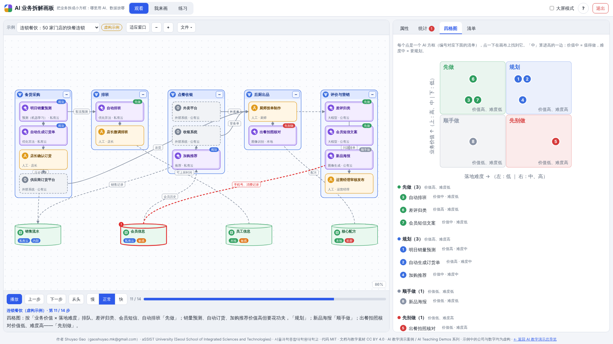
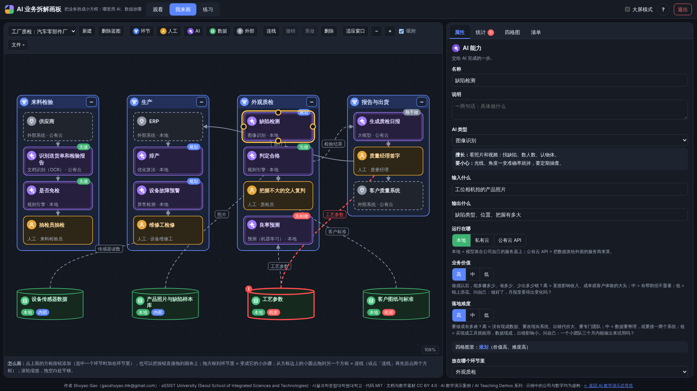
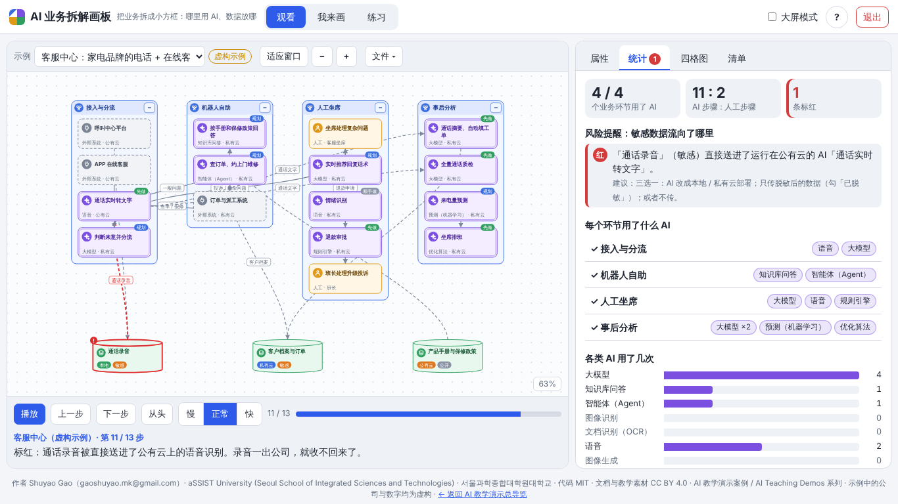
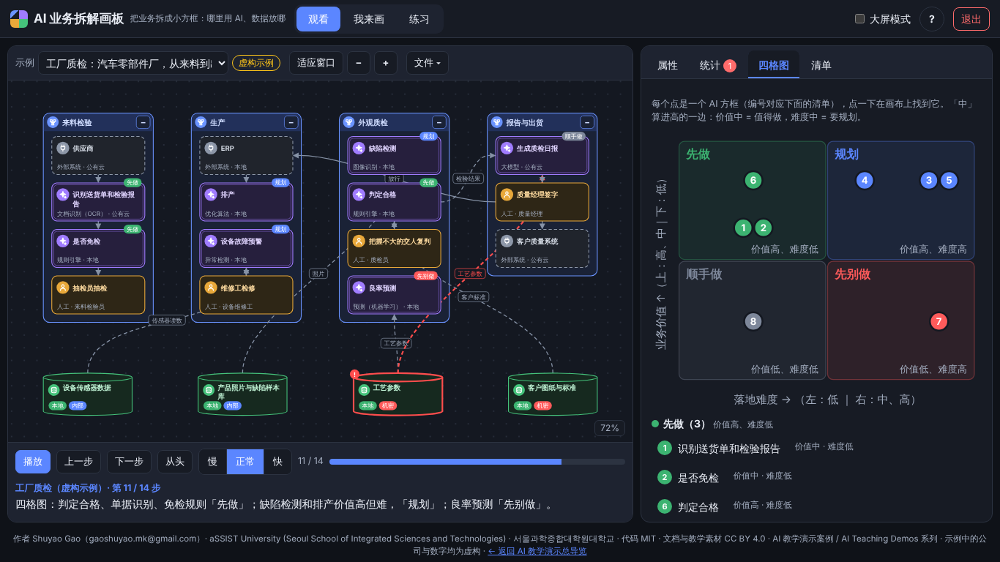
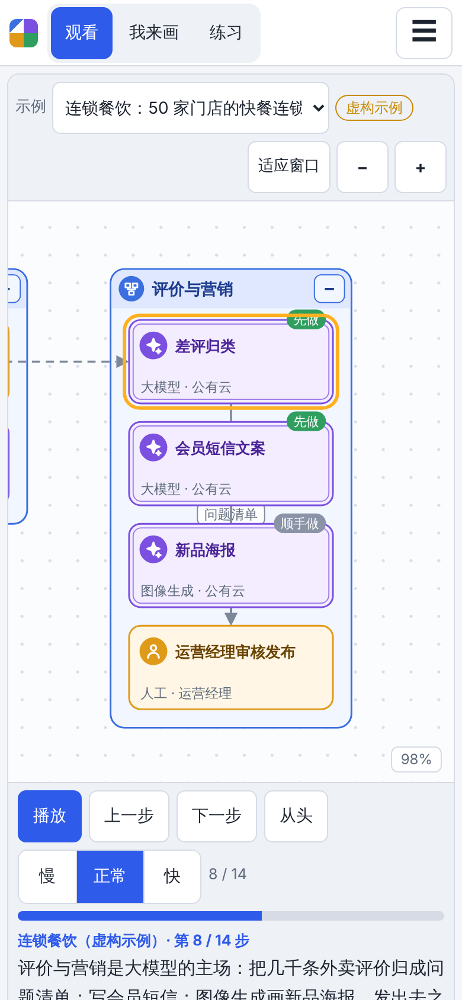
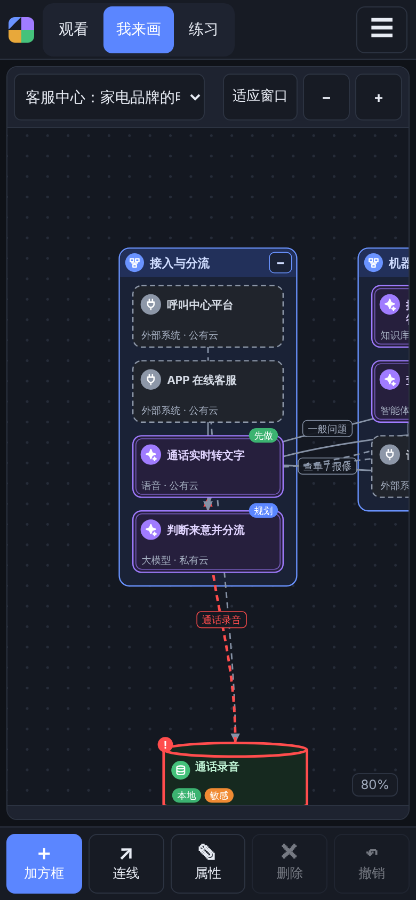
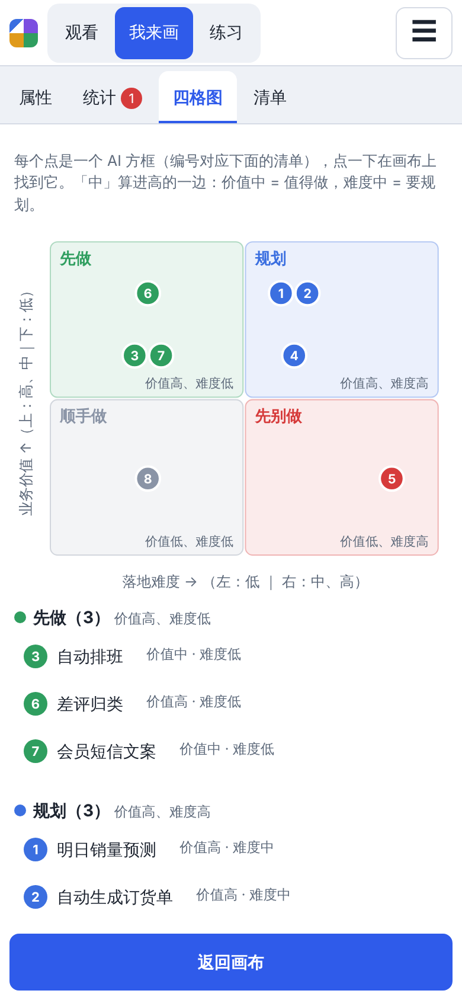

> [← 返回 AI 教学演示总导览](https://shuyaogao.github.io/)

> **AI 教学演示案例 / AI Teaching Demos** 系列

# AI 业务拆解画板（AI Business Blueprint）

**把业务拆成小方框：哪个环节交给 AI、用哪一类 AI、数据放在哪。**

**Shuyao Gao**（gaoshuyao.mk@gmail.com）· aSSIST University (Seoul School of Integrated Sciences and Technologies) · 서울과학종합대학원대학교
代码 MIT · 文档与教学素材 CC BY 4.0

给企业老板和管理层上 AI 课用的画板。不讲算法，只回答三件事：

1. **我的业务能拆成哪些环节？** 用蓝色大框画业务环节，大框里放小步骤，可以一层套一层，拆得很细。
2. **哪些环节交给 AI，用哪一类 AI，具体干什么？** 12 种 AI 类型都配了一句大白话：它擅长什么、要小心什么。每个 AI 步骤写清输入、输出、运行在哪，再打"业务价值"和"落地难度"两个分。
3. **哪些数据必须留在本地，哪些可以上云，数据怎么流动？** 每份数据标存放位置和敏感等级，用虚线画数据流。敏感数据流向公有云的地方自动标红。

画完一键统计：多少环节用了 AI、各类 AI 用了几次、哪些敏感数据上了云；一张四格图排出"先做什么"；最后导出 Markdown 清单，学员课后拿去写方案。内置三个**虚构**示例：连锁餐饮、工厂质检、客服中心，每个拆成 23–24 个方框，配逐步解说。电脑、平板、手机都能用。不用安装、不用联网，纯手写 JavaScript，不依赖任何库。

**English summary.** *AI Business Blueprint* is a browser-only teaching tool (AI Teaching Demos) for executives. Break a business into nested boxes: stages, human steps, AI capabilities, data stores and external systems. Connect them with process and data-flow arrows. Each AI step gets one of 12 plain-language AI types, plus inputs, outputs, where it runs, business value and difficulty. Each data store gets a location (on-premises / private cloud / public cloud) and a sensitivity level. One click shows how many stages use AI, a value-versus-difficulty quadrant, and red or yellow alerts where sensitive data flows to the public cloud. The result exports as a Markdown table. Three fictional worked examples come with narrated walkthroughs. It works on phones, tablets and desktops, from GitHub Pages or straight from `file://`. Hand-written JavaScript, no libraries, no network. UI and documentation are in Chinese.



## 怎么打开：不用安装任何东西

- **手机 / 平板**：点在线链接 <https://shuyaogao.github.io/ai-business-blueprint/>，竖屏体验最好。
- **电脑**：点同一个在线链接；或者在仓库首页点 **Code → Download ZIP**，**解压后**双击 `index.html`（或 `play/index.html`）。

Windows 用自带的 Edge，Mac 用 Safari。一定要先解压，不要在压缩包里直接双击。

## 怎么用

页面顶部三个模式，打开时默认是「观看」：

| 模式 | 你看到什么 | 你能做什么 |
|---|---|---|
| **观看**（默认） | 三个虚构示例逐步拆开（13–14 步），每步一句解说：先画大环节，再一个个放进 AI 和人工步骤，再画数据；然后打开统计、四格图，指出红点并演示怎么消掉，最后打开 Markdown 清单 | 播放 / 暂停、上一步、下一步、从头；慢 / 正常 / 快三档；「示例」换一个；「文件 ▾ → 把这个示例复制到『我来画』」后可以随便改 |
| **我来画** | 工具条、画布、右栏（属性 / 统计 / 四格图 / 清单） | 加五类方框、拖进环节、连线、填属性；多份蓝图自动存在浏览器里；下载 / 打开 .json；导出 PNG；导出 Markdown 清单 |
| **练习** | 一张单独的画布，加 9 项任务，做完自动打勾 | 建 3 个环节 → 往环节里放 2 个步骤 → 加 AI 并选类型 → 填输入输出 → 打价值和难度分 → 加一份放在本地的敏感数据 → 从数据连到 AI → 故意制造一个红点再消掉 → 导出 Markdown |

### 五类方框、两种连线

| 方框 | 样子 | 表示什么 | 属性 |
|---|---|---|---|
| **业务环节** | 蓝色带标题栏的大框 | 一个大环节，里面放小步骤，可以再套环节；右上角 − / + 折叠，折叠后显示"含几个方框、几个 AI" | 名称、说明 |
| **人工步骤** | 琥珀色框，人形图标 | 由人完成的一步 | 名称、说明、谁来做 |
| **AI 能力** | 紫色双边框，星光图标；右上角小标签是它在四格图里的位置 | 交给 AI 的一步 | 名称、说明、**AI 类型**、**输入**、**输出**、**运行在哪**、**业务价值**、**落地难度** |
| **数据 / 存储** | 绿色圆柱，下面两个小标签 | 一份数据 | 名称、说明、**存放位置**、**敏感等级** |
| **外部系统** | 灰色虚线框，插头图标 | 公司已有的软件，或公司外面的平台 | 名称、说明、所在位置 |

连线：**实线 = 业务流程，虚线 = 数据流**，都带箭头，可以写标签（比如"订单数据"）。数据流可以勾**「已脱敏」**。

### 12 种 AI 类型（下拉菜单分 4 组，选中后显示"擅长 / 要小心"）

| 组 | AI 类型 | 擅长干什么 | 要小心 |
|---|---|---|---|
| 文字与对话 | 大模型 | 读懂和写出文字：总结、改写、问答、归类、起草 | 会一本正经地说错，重要输出要人看 |
| | 知识库问答 | 先翻公司自己的资料再回答，答案带出处 | 资料过时它就答错 |
| | 智能体（Agent） | 自己分几步做事：查系统、填表、发通知 | 能动手就可能动错，要限定权限、留记录 |
| 看与听 | 图像识别 | 看照片和视频：找缺陷、数人数、认物体 | 光线、角度一变准确率就掉 |
| | 文档识别（OCR） | 把单据、发票、证件变成文字和表格 | 手写、模糊的要人复核 |
| | 语音 | 语音转文字、文字转语音、听出情绪 | 方言和噪音；录音多含个人信息 |
| | 图像生成 | 按文字描述画图：海报、商品图 | 版权和品牌风格要人把关 |
| 数字与预测 | 预测（机器学习） | 从历史数字找规律，预测明天 | 要足够的历史数据；没见过的情况会失准 |
| | 推荐 | 猜这个人接下来想要什么 | 要有用户行为数据；别过度打扰 |
| | 异常检测 | 发现"和平时不一样"：设备故障、刷单 | 有误报，阈值要调 |
| 规则与决策 | 规则引擎 | 按写清楚的规则自动判断，每一步都能解释 | 不是"学出来的"；规则要人维护 |
| | 优化算法 | 在限制条件下找最省、最快的安排：排班、排产、订货 | 条件写错，结果就"最优地错" |
| 其他 | 其他 / 自定义 | 上面都不合适时选这个 | |

### 数据规则：位置三档、敏感等级四级、红黄提醒

- **存放位置**：本地（公司自己的机房或电脑）/ 私有云（只给本公司用的专属云）/ 公有云（第三方云服务、外部 API）。AI 和外部系统也有"运行在哪"。
- **敏感等级**：公开 / 内部 / 敏感（个人信息、经营数据）/ 机密（核心配方、工艺、图纸、录音这类）。
- **标红**：敏感或机密数据存在公有云；或者一条线把它**直接**送到运行在公有云的 AI、外部系统，而且没勾"已脱敏"。
- **标黄**：机密数据放在私有云；或者敏感数据经"已脱敏"的线上了公有云（提醒你确认脱敏到位）。
- 只看直接连线：数据被中间的 AI 处理过以后已经变成别的东西（比如会员信息 → "分群标签"），不再往下追。

### 业务价值 × 落地难度：四格图

每个 AI 方框打两个分（高 / 中 / 低），属性栏里有一句怎么判断：

- **业务价值**：做成以后能多赚多少、省多少、少出多少错？问自己：做好了，月报里看得出变化吗？
- **落地难度**：有没有现成数据、要不要改现有系统、出错代价大不大？问自己：一个小团队三个月内能做出来试用吗？

四格：**价值高、难度低 = 先做**；价值高、难度高 = 规划；价值低、难度低 = 顺手做；价值低、难度高 = 先别做。「中」算进高的一边（价值中 = 值得做，难度中 = 要规划）。点格子里的点，画布会跳到那个方框并闪一下。



### 操作

- **加方框**：点工具条上的「环节 / 人工 / AI / 数据 / 外部」。选中一个环节时，新的小步骤会放进这个环节里；新环节排在已有环节的右边。也可以把按钮直接拖到画布上。
- **嵌套**：把方框拖进蓝色大框，它就成了这个环节的小步骤，大框会自动撑大；拖出来就脱离。手机上拖不准时，在属性里选「放在哪个环节里」。
- **连线**：电脑上从方框边上的小圆点拖到另一个方框；或者点「连线」（快捷键 L），再先后点两个方框。
- **对齐**：拖动时吸附 8px 网格，并显示和别的方框左 / 中 / 右、上 / 中 / 下对齐的参考线；环节属性里有「里面排整齐」。
- **缩放平移**：滚轮或双指缩放，拖空白处平移，「适应窗口」（F）看全图。
- **键盘**：`1` `2` `3` 切模式，`空格` 观看时播放 / 暂停，`Delete` 删除，`Ctrl+Z / Y` 撤销 / 重做，方向键微移，`Esc` 取消，`H` 看说明。





### 手机和平板（宽度 ≤ 900px）

- **我来画 / 练习**：一屏不滚动。上面是画布：单指拖方框或平移，双指缩放。底部五个大按钮：加方框、连线、属性、删除、撤销。属性、统计、四格图、清单都是全屏面板，点「返回画布」关掉。右上角 ☰ 里放统计、四格图、清单、文件操作、说明和退出。
- **观看**：镜头跟着每一步新出现的方框走；下面是播放控制和解说，再往下是统计、四格图（整页上下滚动）。
- 所有可点区域不小于 44px，页面不会横向滚动。

  

## 三个内置示例（全部虚构）

| 示例 | 环节 | 方框 | AI 用了哪些 | 埋的红点 → 演示的改法 |
|---|---|---|---|---|
| **连锁餐饮**：50 家门店的快餐连锁 | 备货采购、排班、点餐收银、后厨出品、评价与营销 | 24 | 预测、优化 ×2、推荐、图像识别、大模型 ×2、图像生成 | 会员手机号和消费记录直接送进公有云大模型写短信 → 只传"会员分群标签"，勾「已脱敏」（红变黄） |
| **工厂质检**：汽车零部件厂，从来料到出货 | 来料检验、生产、外观质检、报告与出货 | 23 | OCR、规则引擎 ×2、优化、异常检测、图像识别、预测、大模型 | 机密的工艺参数送进公有云大模型写日报 → 大模型改成本地部署（红点消失） |
| **客服中心**：家电品牌的电话 + 在线客服 | 接入与分流、机器人自助、人工坐席、事后分析 | 23 | 语音 ×2、大模型 ×4、知识库问答、智能体、规则引擎、预测、优化 | 通话录音送进公有云语音识别 → 语音识别改成本地部署（红点消失） |

三个示例合起来，12 种 AI 类型每种至少出现一次；每个 AI 方框都填了业务价值和落地难度，四格图的四格都有例子。公司、流程和数字都是编的，只为教学；页面上示例名旁边标着「虚构示例」。

## 课堂上怎么用（推荐顺序，约 40 分钟）

1. **观看**（10 分钟）：放「连锁餐饮」，用「慢」速，每步停下来问一句"你们公司这一步是谁在做？"
2. **讨论红点**（5 分钟）：停在标红那一步，问：会员手机号能不能发给外面的大模型？三种改法各有什么代价？
3. **练习**（10 分钟）：手机打开同一个链接，切到「练习」，按 9 项任务拆一家社区健身房。
4. **拆自己的业务**（15 分钟）：切到「我来画」，拆自己公司的一条业务线，至少拆到 15 个方框；看统计和四格图，挑出 1–2 个"先做"；导出 Markdown 清单，课后写成方案。

讨论题：

1. 你的业务里哪一步"看起来最适合 AI"，在四格图里却落在了「先别做」？为什么？
2. 哪些 AI 步骤后面一定要接一个人工步骤？
3. 你们公司有没有数据"其实已经在公有云上了"，只是以前没人画出来？

## 它是怎么做的

```
点按钮 / 拖拽 / 触摸 ──> Model（方框、嵌套、连线、撤销重做）──> Render（拼 SVG 字符串）──> 画布
                              │
                              └──> Analysis（统计、红黄规则、四格图、Markdown 清单）──> 右栏 / 导出
```

- `play/js/config.js`：五类方框、12 种 AI 类型（擅长 / 要小心）、位置、敏感等级、价值与难度说明、浅色和深色两套配色。
- `play/js/model.js`：数据模型。方框用世界坐标；环节的大小由里面的方框决定（由内向外撑开）；折叠的环节替里面的方框接线。撤销重做存整份快照（最多 200 步）。读 .json 时逐字段检查，坏值改成默认值，父子成环就断开。
- `play/js/analysis.js`：统计、红黄规则、四格图、Markdown 清单，都是纯函数。
- `play/js/render.js`：把蓝图拼成 SVG 字符串。画布显示和导出 PNG 用同一份代码；导出时用浅色配色重画，转成图片后画到 2 倍大小的 canvas 上。
- `play/js/canvas.js`：Pointer Events 统一处理鼠标、手指和触控笔。拖动时先把方框临时移出原来的环节，这样才拖得出来；松手时看指针落在哪个环节里。吸附时先找对齐线，找不到再吸网格。两根手指就进入缩放。
- `play/js/samples.js`：三个示例和逐步解说。布局是自动排的：环节从左到右一行，数据在下面一行。
- `play/js/watch.js`、`practice.js`：观看和练习。`panels.js`：右栏。`store.js`：localStorage 自动保存。`app.js`：页面外壳。`selftest.js`：页面自检。
- 全部是普通 `<script>`，不用模块、CDN 和 fetch，所以双击用 `file://` 打开也能运行。

## 测试

```bash
node tests/js/unit_tests.js              # 45 项单元测试：模型、红黄规则、统计、四格图、Markdown、三个示例、绘制
pip install pytest && python -m pytest   # 静态检查（不联网、不用库、路径 ASCII、署名）+ 上面的单元测试 + 浏览器验收结果
node tools/browser_check.js --shots      # 浏览器验收并重新生成 docs/img/ 截图（需要 npm i playwright 和 Chromium）
python -m tools.build                    # 改了 credits.json 后重新生成 play/js/credits.js（--release 另外打 zip）
```

浏览器验收（`results/browser_check.json`，Chromium 无头模式，Playwright 驱动）：

- **页面自检**：33 项，通过。手动看也可以：打开 `play/index.html?selftest=1`，几秒后标签页标题变成 `SELFTEST PASS`。
- **测试尺寸**：手机 390×844 和 360×780、平板 768×1024、电脑 1366×768 和 1920×1080，深浅色各跑一遍，10 组全部通过。
- **每组检查**：
  - 默认打开观看并自动播放；
  - 没有横向溢出，我来画和练习整页不滚动；
  - 用界面按钮加方框，选中环节时会放进环节里；
  - 连线模式下先后点两个方框能连线；
  - 单指拖方框进环节；
  - 双指缩放；
  - 在属性里选 AI 类型、打分；
  - 手机和平板上，全屏面板、画布页、☰ 菜单里所有可点区域都不小于 44px；
  - 没有 JS 报错。

## 目录结构

```
index.html            根目录入口：自动跳到 play/index.html
.nojekyll             让 GitHub Pages 原样发布
play/                 网页（双击 index.html）：css/app.css 电脑布局与深色模式，css/mobile.css 手机和平板；js/ 见上
tests/                pytest 静态检查 + tests/js/unit_tests.js
tools/                browser_check.js 浏览器验收与截图，build.py 生成 credits.js 和发布 zip
results/              browser_check.json：浏览器验收结果
docs/img/             截图
credits.json          署名、系列名、仓库名
```

## 常见问题

- **我画的蓝图存在哪？** 存在你这个浏览器的 localStorage 里，可以存多份。换电脑、换浏览器或清除网站数据就没了，重要的请「下载 .json」。不会上传任何内容。
- **关掉页面后还有程序在跑吗？** 没有。纯静态网页，关掉标签页就全部结束；右上角「退出」（手机在 ☰ 里）会先停下所有动画。
- **双击后是空白？** 先把整个 zip 解压，再双击解压出来的 `index.html`。
- **红黄规则是法律意见吗？** 不是。它只是课堂上的提醒，帮你看出"哪里有敏感数据出了公司"。具体合不合规，要按你所在地区的法规问法务。
- **Mac 和 iPhone 上能用吗？** 页面只用标准 Web 接口，但只在 Linux 上的 Chromium 无头模式里自动测试过，手机尺寸也是模拟的。Safari（Mac / iPhone）和 Firefox **还没测**，需要在真机上确认一次。

## 许可证与引用

代码 MIT（[LICENSE](LICENSE)），文档与教学素材（README、docs/、页面文字、示例、截图）CC BY 4.0（[LICENSE-docs](LICENSE-docs)），使用请注明出处。
引用信息见 [CITATION.cff](CITATION.cff)（GitHub 右侧的 "Cite this repository"）。第三方说明见 [THIRD_PARTY.md](THIRD_PARTY.md)。联系作者：gaoshuyao.mk@gmail.com。

## AI 辅助开发声明

代码由 Claude Code 辅助编写，经作者审阅。
